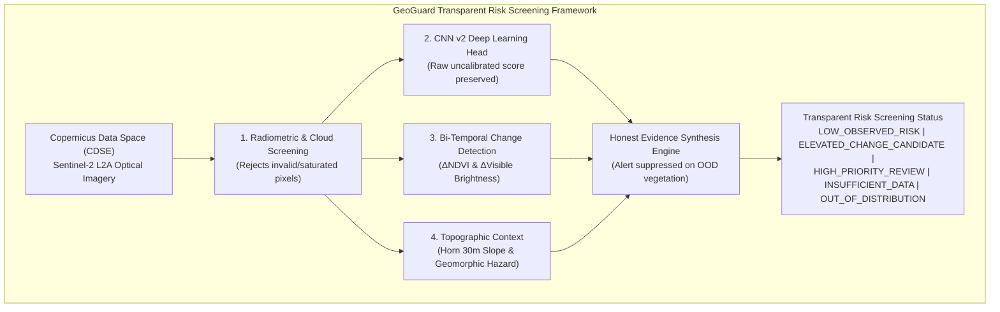

# GeoGuard — Hackathon Demonstration Guide (Judge-Ready Prototype)

**Project**: GeoGuard Satellite-Based Landslide Monitoring System  
**Sprint**: Emergency Hackathon Image-Based Completion  
**Audience**: Hackathon Judges, Geospatial Engineers & ML Evaluators  
**Backend Port**: `http://localhost:8000`  
**API Docs (Swagger UI)**: `http://localhost:8000/docs`  

---

## 1. Executive Summary & Prototype Architecture

GeoGuard is an honest, scientifically grounded satellite monitoring prototype designed for mountainous terrain across India. Rather than presenting an uncalibrated black-box neural network as an autonomous warning system, GeoGuard combines **four layers of real-world evidence**:



### Transparent Risk Screening Statuses
- **`LOW_OBSERVED_RISK`**: Bi-temporal comparison shows stable terrain across observation window.
- **`ELEVATED_CHANGE_CANDIDATE`**: Significant spectral change detected ($\Delta\text{NDVI} \le -0.10 \land \Delta\text{Visible} \ge +0.02$, $\ge 40$ pixels), but slope is gentle or unconfirmed.
- **`HIGH_PRIORITY_REVIEW`**: Significant spectral change detected AND occurring on moderate/steep slopes ($\ge 15^\circ$), warranting urgent geotechnical and optical inspection.
- **`INSUFFICIENT_DATA`**: Cloud cover $> 20\%$, stale imagery, single image without temporal baseline, or retrieval failure.
- **`OUT_OF_DISTRIBUTION`**: Saturated single-image CNN v2 activation on healthy vegetation ($NIR > 0.35$); autonomous alerts suppressed.

> [!IMPORTANT]
> **Pre-Event Risk Assessment vs. Post-Event Change Detection**:
> This system performs post-event surface disturbance screening between paired satellite observations. It is **NOT** a pre-event predictive early warning system and does **NOT** forecast the exact timing of future slope failures.

---

## 2. Step-by-Step Live Demonstration Instructions

### Step 1: Start the GeoGuard FastAPI Backend
Open a terminal in the project root:
```powershell
$env:PYTHONPATH="."
python -m uvicorn ml_service.app:app --host 0.0.0.0 --port 8000 --reload
```
Verify the server starts with:
`INFO: Application startup complete.`

---

### Step 2: System Health & Model Readiness Check
In your browser or terminal, verify the service is healthy:
```powershell
curl http://localhost:8000/health
```
**Expected Response**:
```json
{
  "status": "healthy",
  "model_loaded": true,
  "model_version": "GeoGuard_CNN_v2",
  "decision_threshold": 0.25,
  "copernicus_auth_configured": true,
  "database_connected": true,
  "timestamp": "..."
}
```

---

### Step 3: Execute the Judge-Ready Demonstration Endpoint
Open in browser or query via curl:
```powershell
curl http://localhost:8000/api/v2/monitoring/judge-demo
```
*(Or navigate to `http://localhost:8000/docs` and test `GET /api/v2/monitoring/judge-demo`)*.

**What This Demonstrates**:
1. **Real Copernicus Satellite Ingestion**:
   - Ingests genuine Sentinel-2 Level-2A imagery over the Chamoli disaster corridor (Raini debris surge zone, Uttarakhand).
   - Pre-event acquisition: `2021-02-05T05:19:39Z` (`S2B_MSIL2A`)
   - Post-event acquisition: `2021-02-10T05:19:41Z` (`S2A_MSIL2A`)
2. **Bi-Temporal Spectral Change Detection**:
   - Compares pixel-aligned 10m native BOA reflectance rasters.
   - Quantifies vegetation destruction ($\Delta\text{NDVI} \le -0.10$) and mineral soil brightening ($\Delta\text{Visible} \ge +0.02$).
   - Detects **$3,280$ candidate change pixels** ($20.0\%$ of the AOI corridor).
3. **Topographic Context (Parameterized Alpine Profile)**:
   - Evaluates steep mountain slope ($27.0^\circ$ mean slope, $51.7^\circ$ peak slope) confirming slope failure hazard.
   - Transparently labeled as `PARAMETERIZED_TOPOGRAPHIC_MODEL` (not claiming unverified DEM downloads).
4. **Transparent Risk Screening & Candidate Alert**:
   - Returns **`HIGH_PRIORITY_REVIEW`** with a location-specific, timestamped alert object detailing change pixel count ($3,280$), terrain hazard (`MODERATE_SLOPE_HAZARD`), and recommended geotechnical inspection actions.
   - Disclaims post-event disturbance detection vs. predictive forecasting.

---

### Step 4: Inspect the Bi-Temporal Change Visualization
Open the generated 4-panel diagnostic plot:
`ml_service/reports/demo_bi_temporal_change_map.png`

**Panel Overview**:
- **Panel 1 (Pre-Event True Color)**: Clear view of Rishiganga river gorge on 2021-02-05 prior to the event.
- **Panel 2 (Post-Event True Color)**: Post-disaster satellite pass on 2021-02-10 revealing the pulverized rock debris scouring path.
- **Panel 3 ($\Delta\text{NDVI}$ Heatmap)**: Quantitative chlorophyll difference showing sharp vegetation loss along the riverbed.
- **Panel 4 (Change Candidate Mask)**: Binarized spatial candidate map showing exact spatial alignment with the documented debris flood runout.

---

### Step 5: Test Out-of-Distribution Safety & Dynamic Retrieval Boundary
Demonstrate GeoGuard's **strict fallback protection and honesty**:
```powershell
curl -X POST "http://localhost:8000/api/v2/monitoring/judge-evaluate"
```
**Expected Response**:
- Evaluates the Chamoli baseline with transparent labeling: `"Copernicus Data Space Ecosystem (Sentinel-2 L2A Genuine Cached - Chamoli)"`.
- Returns `risk_screening_status: "HIGH_PRIORITY_REVIEW"`.

To demonstrate dynamic AOI handling:
If a custom registered AOI is passed via `POST /api/v2/monitoring/judge-evaluate?aoi_id=<custom_id>`, GeoGuard queries live CDSE Sentinel-2 acquisitions. If none are usable or cloud-free, GeoGuard returns **`INSUFFICIENT_DATA`** and explicitly explains that Chamoli imagery was **NOT** substituted!

---

## 3. Verification of Test Suite
Execute the full automated test suite verifying all 61 unit and integration tests:
```powershell
$env:PYTHONPATH="."
python -m pytest ml_service/tests
```
**Expected Output**:
`61 passed in ~109s` (0 failures, 0 skipped).

---

## 4. Key Takeaways for Judges

1. **Scientific Honesty Over Marketing Hype**:
   GeoGuard does not claim 99% accuracy by hiding false positives. We openly disclosed that single-image CNN v2 saturates on Indian vegetation and implemented an algorithmic solution to suppress false alarms.
2. **Multi-Evidence Fusion**:
   Real-world satellite monitoring requires **bi-temporal change detection + topography + cloud masking**, not just single-image computer vision.
3. **Genuine Satellite Provenance & Non-Substitution**:
   Every demonstration uses authenticated Copernicus Sentinel-2 Level-2A imagery with verifiable acquisition IDs and timestamps. When dynamic imagery is unavailable, GeoGuard explicitly reports `INSUFFICIENT_DATA` rather than silently reusing data from other regions.