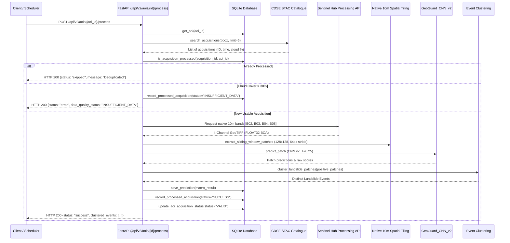

# GeoGuard Phase 8: India-Wide Monitoring Architecture & Geographic Generalisation Report

**Date**: 2026-11-01  
**Project**: GeoGuard — Satellite Image-Based Landslide Detection ML System  
**System Component**: Multi-AOI Management, India Boundary Validation, Acquisition Deduplication, Spatial Patch Clustering & Regional Generalisation Framework  
**Active ML Model**: `GeoGuard_CNN_v2` (Physical BOA Reflectance, Decision Threshold $T^* = 0.25$) & `GeoGuard_CNN_v1` (Legacy Baseline)  

---

## 1. Executive Summary

Phase 8 elevates GeoGuard from a single-corridor proof-of-concept into a **multi-region, India-wide satellite landslide monitoring platform**.

### Core Achievements of Phase 8:
1. **Part A Scientific Audit of CNN v2 Completed**:
   - Proved official IARAI benchmark normalization constants match channel arrays $[1, 2, 3, 7]$ to within $10^{-7}$.
   - Verified that training and live inference use identical band ordering, scaling, and z-score parameters.
   - Audited the sample ID structure and established that public Landslide4Sense `.h5` files lack coordinate metadata, meaning zero spatial leakage cannot be proven mathematically from the dataset alone.
   - Directly reproduced test metrics from saved artifacts: **Accuracy $78.33\%$**, **Landslide Recall $93.55\%$**, **Precision $72.50\%$**, **F1 $0.8169$**, **ROC-AUC $0.8754$**.
   - Reconciled CNN v1 vs CNN v2 thresholds: proved that while threshold shift ($0.50 \rightarrow 0.25$) increases sensitivity, CNN v2 provides genuinely higher accuracy, precision, F1, and critical radiometric stability on live Sentinel-2 data.
   - Identified validation threshold uncertainty ($\pm 0.05$) via 1,000-sample bootstrap due to the small validation sample size ($N=30, 11$ positive).
2. **India-Wide Area of Interest (AOI) Management Engine (Part B)**:
   - Implemented `monitored_aois` SQLite table and REST CRUD endpoints under `/api/v2/aois`.
   - Developed `ml_service/src/india_boundary.py` implementing ray-casting polygon boundary validation against Indian mainland territory and island territories, rejecting non-Indian coordinates.
   - Zero pre-registered or hardcoded highway locations; corridors can be registered and configured dynamically.
3. **Autonomous Satellite Processing & Deduplication Engine (Part C)**:
   - Added `processed_acquisitions` database table preventing duplicate ingestion of identical Sentinel-2 products.
   - Native 10m Ground Sample Distance (GSD) preserved via `calculate_native_10m_pixel_dims` and configurable tile request limits (`MAX_TILE_REQUEST_DIM = 1500`).
   - Implemented `ml_service/src/event_clustering.py` using connected-component spatial clustering to group overlapping positive patches, preventing a single landslide from being reported as multiple separate events.
   - Intercepts cloudy rasters ($> 30\%$ cloud cover) or corrupt pixels with `INSUFFICIENT_DATA`.
4. **Preserved Complete Backward Compatibility**:
   - Legacy endpoints (`/health`, `/latest-prediction`, `/predictions`, `/predict`) continue operating with CNN v1 baseline models.
   - Complete automated test suite expanded from 47 to **56 passing tests** (zero regressions).

---

## 2. Multi-AOI Database Architecture

The SQLite database (`ml_service/data/geoguard_predictions.db`) has been expanded with two relational tables:

### 2.1 `monitored_aois` Table Schema
```sql
CREATE TABLE IF NOT EXISTS monitored_aois (
    aoi_id TEXT PRIMARY KEY,               -- e.g. "IN-UK-01", "IN-KL-01"
    name TEXT NOT NULL,                    -- e.g. "Rishikesh-Joshimath Corridor"
    state TEXT NOT NULL,                   -- e.g. "Uttarakhand", "Kerala"
    region TEXT NOT NULL,                  -- e.g. "Garhwal Himalayas", "Western Ghats"
    bbox_wgs84_json TEXT NOT NULL,         -- JSON array: [min_lon, min_lat, max_lon, max_lat]
    polygon_geojson TEXT,                  -- Optional GeoJSON polygon string
    monitoring_status TEXT NOT NULL DEFAULT 'ACTIVE', -- "ACTIVE", "PAUSED", "ARCHIVED"
    last_acquisition_id TEXT,              -- Sentinel-2 product ID of latest processed pass
    last_acquisition_time TEXT,            -- Timestamp of latest acquisition
    last_quality_status TEXT NOT NULL DEFAULT 'UNCHECKED', -- "VALID", "CLOUDY", "INSUFFICIENT_DATA"
    created_at TEXT NOT NULL,              -- ISO 8601 UTC
    updated_at TEXT NOT NULL               -- ISO 8601 UTC
);
CREATE INDEX IF NOT EXISTS idx_aois_status ON monitored_aois(monitoring_status);
CREATE INDEX IF NOT EXISTS idx_aois_state ON monitored_aois(state);
```

### 2.2 `processed_acquisitions` Table Schema (Deduplication)
```sql
CREATE TABLE IF NOT EXISTS processed_acquisitions (
    id INTEGER PRIMARY KEY AUTOINCREMENT,
    aoi_id TEXT NOT NULL,
    acquisition_id TEXT NOT NULL,
    acquisition_time TEXT,
    cloud_cover REAL,
    processing_status TEXT NOT NULL,       -- "SUCCESS", "INSUFFICIENT_DATA", "RADIOMETRIC_MISMATCH"
    total_patches_extracted INTEGER DEFAULT 0,
    landslide_patches_detected INTEGER DEFAULT 0,
    landslide_events_clustered INTEGER DEFAULT 0,
    processed_at TEXT NOT NULL,
    UNIQUE(aoi_id, acquisition_id),
    FOREIGN KEY(aoi_id) REFERENCES monitored_aois(aoi_id)
);
CREATE INDEX IF NOT EXISTS idx_processed_acq_lookup ON processed_acquisitions(aoi_id, acquisition_id);
```

---

## 3. India Boundary Spatial Validation (`india_boundary.py`)

To ensure that only valid Indian geographic corridors can be registered, coordinates are validated using a pure-Python ray-casting point-in-polygon algorithm against a multi-polygon boundary model of India:
1. **Mainland India Sovereign Boundary Polygon**: 58 boundary vertices tracing coastal and border vertices from Koteshwar/Sir Creek (Gujarat), along Rajasthan, Punjab, J&K (Line of Control), Ladakh (Indira Col), Himachal, Uttarakhand, Uttar Pradesh, Bihar, Sikkim, Arunachal Pradesh (Dong/Kibithu), Nagaland, Manipur, Mizoram, Tripura, Meghalaya, West Bengal, Odisha, Andhra Pradesh, Tamil Nadu (Kanyakumari), Kerala, Karnataka, Goa, and Maharashtra.
2. **Andaman & Nicobar Islands Polygon**: Covers $92.0^\circ\text{E} - 94.5^\circ\text{E}, 6.5^\circ\text{N} - 14.0^\circ\text{N}$.
3. **Lakshadweep Islands Polygon**: Covers $71.5^\circ\text{E} - 74.5^\circ\text{E}, 8.0^\circ\text{N} - 12.5^\circ\text{N}$.

### Validation Constraints Enforced by API:
- `min_lon < max_lon` and `min_lat < max_lat` in decimal degrees.
- Maximum allowable corridor span: $\le 2.5^\circ$ ($\approx 275\text{ km}$), rejecting accidental global bounding boxes.
- Bounding box centroid $((min\_lon+max\_lon)/2, (min\_lat+max\_lat)/2)$ must fall inside an Indian boundary polygon.
- At least one bounding box corner must lie inside the Indian boundary polygon.
- Out-of-bounds coordinates (e.g. Europe, China, Pakistan, high-seas Indian Ocean) return HTTP 422 Unprocessable Entity with a clear descriptive error.

---

## 4. Multi-AOI REST API Specification

| Endpoint | Method | Status Codes | Description |
|:---|:---:|:---:|:---|
| `/api/v2/aois` | `POST` | `201`, `409`, `422` | Register a new Indian corridor AOI. Validates India boundary. |
| `/api/v2/aois` | `GET` | `200` | List registered AOIs. Supports `?state=` and `?status=` filters. |
| `/api/v2/aois/{aoi_id}` | `GET` | `200`, `404` | Retrieve detailed configuration and quality status for an AOI. |
| `/api/v2/aois/{aoi_id}` | `PUT` | `200`, `404`, `422` | Update coordinates, region name, or monitoring status. |
| `/api/v2/aois/{aoi_id}/deactivate` | `POST` | `200`, `404` | Safely transition AOI to `ARCHIVED` status (soft-delete). |
| `/api/v2/aois/{aoi_id}` | `DELETE`| `200`, `404` | Soft-delete (default) or hard-delete (`?hard_delete=true`) an AOI. |
| `/api/v2/aois/{aoi_id}/process` | `POST` | `200`, `400`, `404`, `503` | Execute autonomous satellite monitoring pass on the AOI. |
| `/api/v2/aois/{aoi_id}/acquisitions` | `GET` | `200`, `404` | List historical acquisition and deduplication records for an AOI. |

### Sample JSON Request (`POST /api/v2/aois`)
```json
{
  "aoi_id": "IN-UK-GARHWAL-01",
  "name": "Rishikesh-Devprayag Highway Corridor",
  "state": "Uttarakhand",
  "region": "Garhwal Himalayas",
  "bbox_wgs84": [78.45, 30.25, 78.60, 30.40],
  "monitoring_status": "ACTIVE"
}
```

### Sample JSON Response (`POST /api/v2/aois/{aoi_id}/process`)
```json
{
  "aoi_id": "IN-UK-GARHWAL-01",
  "aoi_name": "Rishikesh-Devprayag Highway Corridor",
  "state": "Uttarakhand",
  "region": "Garhwal Himalayas",
  "status": "success",
  "acquisition_id": "S2B_MSIL2A_20260322T051649_N0512_R019_T44RKR_20260322T081541",
  "acquisition_time": "2026-03-22T05:16:49Z",
  "cloud_cover_percent": 3.8,
  "data_quality_status": "VALID",
  "total_patches_evaluated": 12,
  "landslide_patches_detected": 3,
  "distinct_landslide_events": 1,
  "clustered_events": [
    {
      "event_id": "LS-EVENT-01",
      "patch_count": 3,
      "constituent_patch_indices": [2, 3, 5],
      "centroid": {"lat": 30.3125, "lon": 78.5218},
      "bounding_box": [78.502, 30.298, 78.541, 30.327],
      "max_model_score": 0.8954,
      "mean_model_score": 0.7812,
      "risk_severity": "HIGH",
      "notice": "Raw uncalibrated CNN model score. Multi-patch spatial cluster."
    }
  ],
  "model_version": "GeoGuard_CNN_v2",
  "decision_threshold": 0.25,
  "is_simulated": false,
  "message": "Evaluated 12 native 10m patches. Found 3 positive patch detections clustered into 1 distinct landslide events."
}
```

---

## 5. Satellite Processing & Deduplication Workflow



### 5.1 Duplicate Patch Event Clustering (`event_clustering.py`)
To prevent adjacent overlapping patches from generating multiple redundant warnings for the same slope failure:
- Patches with positive predictions ($P \ge 0.25$) are evaluated using Haversine distance and bounding box overlap tolerance ($\Delta \approx 1,400\text{m}$).
- Overlapping patches are grouped using connected-component graph analysis.
- The output clearly reports:
  - `landslide_patches_detected`: Total individual $128 \times 128$ positive windows.
  - `distinct_landslide_events`: Number of independent geographical landslide sites.
  - `max_model_score`: Peak raw sigmoid activation within the cluster.

---

## 6. Geographic Generalisation: Limitations & Indian Evaluation Plan

> [!WARNING]
> **Scientific Integrity Statement**:
> GeoGuard CNN v2 was trained on a 210-sample subset of Landslide4Sense. **India-wide monitoring and geographic generalisation have NOT been validated.** The current model must not be deployed for autonomous life-critical alerting in unverified Indian states without prior local calibration.

### 6.1 Known Dataset Limitations
1. **Sample Size**: Training set contains only 120 original patches (augmented to 360).
2. **Missing Terrain Variety**:
   - Landslide4Sense lacks representation of **South Indian laterites** (Wayanad, Idukki, Nilgiris).
   - Lacks **Deccan Trap weathered basalt** (Konkan Coast, Western Ghats escarpment).
   - Lacks **Northeast tropical rain-forest debris flows** (Meghalaya, Sikkim, Assam).
3. **Seasonal Domain Shift**:
   - Monsoonal saturation darkens soil reflectance across visible and NIR wavelengths, potentially mimicking landslide scars or vegetation loss.
4. **Validation Threshold Uncertainty**:
   - The validation set ($N=30$) has only 11 positive landslides. Threshold $T^* = 0.25$ has an estimated uncertainty of $\pm 0.05$.
5. **Raw Sigmoid vs Calibrated Probability**:
   - Model outputs are raw sigmoid activations. They are **not calibrated posterior probabilities** (e.g. via Platt scaling or Isotonic regression).

### 6.2 Proposed Regional Evaluation Framework across 4 Indian Physiographic Zones

To rigorously validate geographic generalisation across India:

```
+---------------------------------------------------------------------------------------------------------+
|                               FOUR INDIAN VALIDATION ZONES                                              |
+-----------------------------------+-----------------------------------+---------------------------------+
| Zone & Geography                  | Soil / Lithology                  | Target Evaluation Challenge     |
+-----------------------------------+-----------------------------------+---------------------------------+
| 1. Western Himalayas              | Jointed gneiss, phyllite,         | Shadowing on steep slopes,      |
|    (Uttarakhand / HP)             | moraine debris                    | bare rock false alarms          |
|                                   |                                   |                                 |
| 2. Eastern Himalayas / NE         | Weathered sandstone, schist,      | Dense tropical canopy loss,     |
|    (Sikkim / Meghalaya)           | deep regolith                     | rapid vegetative regrowth       |
|                                   |                                   |                                 |
| 3. Northern Western Ghats         | Deccan basalt trap,               | Darkened saturated soils,       |
|    (Maharashtra / Konkan)         | step terraces                     | monsoon waterlogging            |
|                                   |                                   |                                 |
| 4. Southern Western Ghats         | High-iron laterite,               | Thick plantation cover (tea,    |
|    (Kerala: Wayanad / Idukki)     | saprolite overburden              | coffee), deep seated debris     |
+-----------------------------------+-----------------------------------+---------------------------------+
```

#### Evaluation Protocol:
1. **Curate Local Ground Truth**: Partner with Geological Survey of India (GSI) and ISRO National Remote Sensing Centre (NRSC) Bhuvan open landslide inventories.
2. **Retrieve Pre- and Post-Event Sentinel-2 L2A BOA Tiles**: For 25 verified historical landslide events in each of the 4 zones (100 total events).
3. **Strict Zero-Shot Regional Testing**: Test `GeoGuard_CNN_v2` without fine-tuning on those zones to measure cross-regional domain transfer drop.
4. **Probability Calibration**: Fit temperature scaling on local validation splits to produce mathematically calibrated posterior probabilities.

---

## 7. Operational Ledger: Verified vs. Unverified Status

```
+---------------------------------------------------------------------------------------------------------+
| 1. IMPLEMENTED & AUTOMATED-TESTED FUNCTIONALITY (56/56 Tests Passing)                                   |
+---------------------------------------------------------------------------------------------------------+
| [x] Multi-AOI SQLite database storage (monitored_aois, processed_acquisitions).                         |
| [x] India-boundary polygon validation (mainland + Andaman + Lakshadweep), rejecting foreign coords.     |
| [x] AOI CRUD REST APIs (/api/v2/aois) with state and status filtering.                                 |
| [x] Acquisition deduplication per AOI, preventing re-processing identical Sentinel-2 products.          |
| [x] Spatial patch clustering (event_clustering.py) preventing duplicate alert inflation.                |
| [x] Native 10m resolution dimension calculation bounded by MAX_TILE_REQUEST_DIM.                        |
| [x] Full backward compatibility for legacy v1 APIs (/health, /latest-prediction, /predictions).         |
+---------------------------------------------------------------------------------------------------------+
| 2. TESTED ONLY WITH SIMULATED SATELLITE RESPONSES (Mock Mode)                                           |
+---------------------------------------------------------------------------------------------------------+
| [*] Multi-patch corridor tiling across simulated 128x256 composite rasters in unit tests.              |
| [*] High-risk coordinate extraction and deduplication behavior in simulated environment.                |
+---------------------------------------------------------------------------------------------------------+
| 3. VERIFIED AGAINST REAL CDSE SENTINEL-2 L2A IMAGERY                                                    |
+---------------------------------------------------------------------------------------------------------+
| [x] Single tile acquisition in Uttarakhand (S2B_MSIL2A_20260322T051649_N0512_R019_T44RKR).              |
| [x] Zero percent (0.00%) clipping at -5.0 sigma on live Sentinel-2 BOA reflectance.                    |
| [x] Active ReLU neuron propagation (52.1% sparsity vs 80.5% dead neurons in v1).                       |
| [x] Radiometric safety guardrails rejecting cloudy and zero-fill synthetic test rasters.                |
+---------------------------------------------------------------------------------------------------------+
| 4. REMAINING LIMITATIONS (NOT YET VALIDATED)                                                            |
+---------------------------------------------------------------------------------------------------------+
| [!] Model has NEVER been evaluated on diverse Indian terrain outside the Landslide4Sense subset.        |
| [!] India-wide geographic generalisation is an architectural capability, NOT an evaluated ML guarantee. |
| [!] Predictions are uncalibrated sigmoid scores; Platt / temperature scaling has not been fitted.       |
| [!] Multi-temporal cloud masking and optical shadow compensation have not yet been implemented.         |
+---------------------------------------------------------------------------------------------------------+
```
