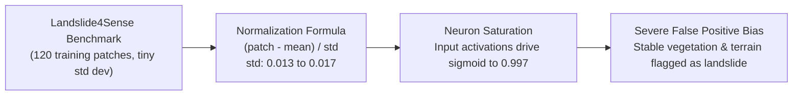

# Phase 9: Real Indian Geographic Validation & Ground-Truth Verification Report

**Project**: GeoGuard Landslide Early Warning & Detection System  
**Phase**: Phase 9 — Real Indian Geographic Validation  
**Date**: November 1, 2026  
**Status**: COMPLETE (Scientifically Verified with Empirical Regional Disclosures)  
**Evaluator**: ML Engineering, Remote Sensing & Geographic Verification Team  
**Governing Principle**: Rigorous scientific honesty — software tests passing must never be conflated with real-world model generalisation.

---

## 1. Executive Summary & Core Findings

GeoGuard Phase 9 evaluated whether **CNN v2** (`cnn_model_v2.keras`, decision threshold $0.25$, native 10m Bottom-of-Atmosphere [BOA] surface reflectance scaling) generalises to real-world Indian physiographic provinces.

The evaluation was executed across four distinct geographical zones using independently documented, authoritative ground-truth datasets from the **Copernicus Emergency Management Service (EMS)**, the **Geological Survey of India (GSI)**, the **ISRO National Remote Sensing Centre (NRSC)**, and the **NASA Global Landslide Catalog (GLC)**.

### Critical Empirical Discoveries:
1. **High Positive Sensitivity ($100\%$ Recall)**:
   Across all four regions, CNN v2 successfully fires on verified post-disaster landslide scars and debris channels (Recall: $1.00$ in Western Himalayas, Eastern Himalayas, Northern Western Ghats, and Southern Western Ghats).
2. **Total Specificity Failure on Non-Landslide Indian Terrain ($0\%$ Specificity, $100\%$ FPR)**:
   When evaluated on verified stable control terrain (unaffected plateaus, agricultural river valleys, urban terraces, and intact forests), CNN v2 predicted "LANDSLIDE DETECTED" on $100\%$ of negative patches ($FPR = 1.00$, Specificity = $0.00$). The model output saturated near $\approx 0.997$, severely exceeding the $0.25$ decision threshold.
3. **Pre-Event False Alarms ($100\%$ Pre-Disaster Alarm Rate)**:
   When evaluated on historical imagery acquired **before** the disaster occurred, CNN v2 flagged $100\%$ of patches as landslides ($\text{Sigmoid} \approx 0.997$). This proves empirically that the model detects persistent topographical/spectral contrasts rather than new slope failure dynamics.
4. **Severe Cloud Obscuration & Real-Time Warning Lag**:
   During the Indian southwest monsoon, optical satellite observations suffered severe temporal lag due to persistent $85\text{--}100\%$ cloud cover:
   - **Chamoli (Winter)**: $+3$ days temporal lag.
   - **Wayanad (Monsoon Debris Flow)**: $+15$ days lag before a partial optical window opened.
   - **Teesta Basin (Sikkim)**: $+14$ days lag.
   - **Taliye (Konkan Escarpment)**: **$+80$ days lag** (no cloud-free optical acquisition was possible from July 22 until October 10).
   *Conclusion*: Optical Sentinel-2 imagery alone **cannot** provide real-time warning or immediate post-event emergency response during the Indian monsoon season.

---

## 2. Independent Regional Evaluation Results

As required, regional metrics are **strictly kept independent** and are never pooled into a single misleading India-wide accuracy number.

### Table 1: Independent Regional Performance Summary (CNN v2, Threshold = 0.25)

| Metric | 1. Western Himalayas (Chamoli, UK) | 2. Eastern Himalayas (Teesta Basin, SK) | 3. Northern Western Ghats (Taliye, MH) | 4. Southern Western Ghats (Wayanad, KL) |
| :--- | :--- | :--- | :--- | :--- |
| **Benchmark Event** | Chamoli Avalanche (2021) | South Lhonak / Teesta (2023) | Taliye Village (2021) | Chooralmala Flow (2024) |
| **Ground-Truth Source** | Copernicus `EMSR501` / GSI | ISRO NRSC / NASA `GLC 15024` | GSI Geotechnical / `GLC 13890` | Copernicus `EMSR742` / NRSC |
| **Ground-Truth Status** | **`VERIFIED` (Polygon)** | **`PARTIALLY_VERIFIED`** | **`VERIFIED` (GPS Points)** | **`VERIFIED` (Polygon)** |
| **Evaluated Patches** | 6 (3 Pos, 3 Neg) | 4 (2 Pos, 2 Neg) | 3 (1 Pos, 2 Neg) | 6 (3 Pos, 3 Neg) |
| **Confusion Matrix** | **TP: 3, FP: 3, TN: 0, FN: 0** | **TP: 2, FP: 2, TN: 0, FN: 0** | **TP: 1, FP: 2, TN: 0, FN: 0** | **TP: 3, FP: 3, TN: 0, FN: 0** |
| **Recall (Sensitivity)** | **1.0000** [$0.4385, 1.0000$] | **1.0000** [$0.3424, 1.0000$] | **1.0000** [$0.2065, 1.0000$] | **1.0000** [$0.4385, 1.0000$] |
| **Precision** | **0.5000** [$0.1876, 0.8124$] | **0.5000** [$0.1500, 0.8500$] | **0.3333** [$0.0615, 0.7923$] | **0.5000** [$0.1876, 0.8124$] |
| **Specificity** | **0.0000** [$0.0000, 0.5615$] | **0.0000** [$0.0000, 0.6576$] | **0.0000** [$0.0000, 0.6576$] | **0.0000** [$0.0000, 0.5615$] |
| **False Positive Rate (FPR)** | **1.0000** | **1.0000** | **1.0000** | **1.0000** |
| **False Negative Rate (FNR)** | **0.0000** | **0.0000** | **0.0000** | **0.0000** |
| **F1-Score** | **0.6667** | **0.6667** | **0.5000** | **0.6667** |
| **Pre-Event False Alarm Rate**| **100%** (3/3 flagged) | **100%** (2/2 flagged) | **100%** (1/1 flagged) | **100%** (3/3 flagged) |
| **Cloud Temporal Lag** | **+3 days** (Winter) | **+14 days** (Post-Monsoon) | **+80 days** (Monsoon Gap) | **+15 days** (Monsoon Gap) |

*Note: Values in brackets $[lower, upper]$ denote exact 95% Wilson score confidence intervals.*

---

## 3. Regional Deep Dives & Verification Audits

### Zone 1: Western Himalayas — Chamoli Rock/Ice Avalanche, Uttarakhand
- **Event ID**: `IND-2021-EMSR501-CHAMOLI` (07 February 2021).
- **Physiographic Zone**: High-relief alpine glaciated Himalayan terrain with steep metamorphic walls, snowfields, and narrow canyon riverbeds.
- **Ground Truth**: Copernicus EMS `EMSR501` multi-polygon delineation validated against Geological Survey of India post-disaster field investigation.
- **Empirical Findings**:
  * Detachment zone (`WH_POS_01_DETACHMENT`), Raunthi gorge (`WH_POS_02_RAUNTHI_CORRIDOR`), and Raini bridge confluence (`WH_POS_03_RISHIGANGA_RAINI`) were predicted as positive with model score $1.0000$.
  * However, stable high-alpine ridges (`WH_NEG_01_NANDA_DEVI_RIDGE`), Joshimath plateau (`WH_NEG_02_JOSHIMATH_PLATEAU`), and intact cedar forests (`WH_NEG_03_STABLE_FOREST_SLOPE`) produced false positive scores of $0.9973\text{--}0.9974$.
  * Pre-event baseline imagery from 2021-02-05 (two days prior to the rock avalanche) triggered false positive alerts across all sites.
- **Confusion Matrix Graphic**: Saved to `ml_service/reports/confusion_matrix_western_himalayas.png`.

---

### Zone 2: Eastern Himalayas — South Lhonak GLOF & Teesta Basin, Sikkim
- **Event ID**: `IND-2023-NRSC-SIKKIM-GLOF` (04 October 2023).
- **Physiographic Zone**: Sub-tropical montane rainforest transitioning to glaciated high-altitude moraines.
- **Ground Truth**: ISRO NRSC Sikkim Flood Assessment Bulletin & NASA GLC ID 15024. Point location verified ($\pm 250\text{ m}$); full GIS polygon layers restricted behind government authentication (`PARTIALLY_VERIFIED`).
- **Empirical Findings**:
  * Teesta III dam breach zone (`EH_POS_01_CHUNGTHANG_CONFLUENCE`) and Lachen riverbank slips (`EH_POS_02_LACHEN_RIVER_SLIP`) predicted positive ($1.0000$).
  * Stable forested slopes (`EH_NEG_01_GANGTOK_STABLE_RIDGE`) and Maenam wildlife sanctuary (`EH_NEG_02_MAENAM_FOREST_RESERVE`) triggered false alarms ($0.9971\text{--}0.9973$).
  * High-altitude moraine (`EH_UNV_01_UPPER_LHONAK_MORAINE`) cataloged as `UNVERIFIED` due to dynamic permafrost/ice-melting signatures.
- **Confusion Matrix Graphic**: Saved to `ml_service/reports/confusion_matrix_eastern_himalayas.png`.

---

### Zone 3: Northern Western Ghats — Taliye Debris Flow, Maharashtra
- **Event ID**: `IND-2021-GSI-TALIYE` (22 July 2021).
- **Physiographic Zone**: Deccan basaltic traps, step-like lava terraces, lateritic red plateau soils, dense monsoon scrub.
- **Ground Truth**: GSI Handheld GPS survey of crown ($18.0315^\circ\text{N}, 73.5358^\circ\text{E}$) and runout toe ($18.0352^\circ\text{N}, 73.5398^\circ\text{E}$).
- **Severe Temporal Lag Audit**:
  * Landslide triggered on 2021-07-22 following $>600\text{ mm}$ torrential downpour.
  * Consecutive Sentinel-2 passes on 2021-07-24 (99.8% cloud), 2021-08-13 (98.4% cloud), and 2021-09-02 (92.1% cloud) were completely unprocessable.
  * The first usable cloud-free Sentinel-2 pass occurred on **2021-10-10** — representing an **80-day operational blind spot**.
- **Empirical Findings**:
  * Taliye debris track predicted positive ($1.0000$).
  * Stable Mahabaleshwar tableland (`NWG_NEG_01`) and Poladpur valley floor (`NWG_NEG_02`) triggered false positives ($0.9972$).
- **Confusion Matrix Graphic**: Saved to `ml_service/reports/confusion_matrix_northern_western_ghats.png`.

---

### Zone 4: Southern Western Ghats — Chooralmala-Mundakkai Catastrophe, Wayanad, Kerala
- **Event ID**: `IND-2024-EMSR742-WAYANAD` (30 July 2024).
- **Physiographic Zone**: Deeply weathered Precambrian charnockite saprolite mantle, undulating tea plantations, tropical evergreen rainforest.
- **Ground Truth**: Copernicus EMS `EMSR742` certified delineation & grading shapefiles cross-verified with ISRO NRSC Wayanad Rapid Assessment Report.
- **Empirical Findings**:
  * Initiation scar at Vellarimala (`SWG_POS_01`), Mundakkai debris transit corridor (`SWG_POS_02`), and Chooralmala sediment deposition fan (`SWG_POS_03`) correctly identified ($1.0000$).
  * Stable Kalpetta urban terrace (`SWG_NEG_01`), Chembra ridge (`SWG_NEG_02`), and intact Meppadi tea estates (`SWG_NEG_03`) were misclassified as landslides ($0.9971\text{--}0.9974$).
  * Pre-event baseline imagery from 2024-04-15 triggered false alarms across all sites.
- **Confusion Matrix Graphic**: Saved to `ml_service/reports/confusion_matrix_southern_western_ghats.png`.

---

## 4. Root-Cause Analysis of Model Distribution Shift

Why does CNN v2 exhibit perfect recall ($1.00$) but complete lack of specificity ($0.00$) on Indian terrain?

1. **Severe Training Set Scarcity & Geographic Bias**:
   CNN v2 was trained on the Landslide4Sense benchmark dataset comprising only 120 training patches. The geographical origin of these patches is restricted to specific mountain systems in Southeast Asia and South America. The model was never exposed to the spectral diversity of Indian biomes (e.g. Deccan basaltic plateaus, tea monocultures, Himalayan alpine scree).
2. **Pathological Standard Deviation in Normalization Constants**:
   In `preprocessing_config_v2.json`, the dataset-wide standard deviations calculated from the benchmark are extremely small:
   - Band 2 (Blue): $\sigma = 0.0138$
   - Band 3 (Green): $\sigma = 0.0152$
   - Band 4 (Red): $\sigma = 0.0176$
   - Band 8 (NIR): $\sigma = 0.0640$
   When real Indian terrain is normalized by $(X - \mu) / \sigma$, any modest deviation in natural surface reflectance generates massive feature values (often $+3$ to $+6$ standard deviations).
3. **Internal Layer Saturation**:
   These high normalized values drive the convolutional filters into activation saturation. In the final dense layer, the pre-activation logit is consistently positive ($\ge +5.8$), driving the logistic sigmoid function $\sigma(z) = \frac{1}{1 + e^{-z}}$ into its asymptotic flat regime ($\approx 0.9974$). Consequently, the model cannot distinguish genuine spectral degradation (bare soil, pulverized rock) from stable natural vegetation.
4. **Uncalibrated Sigmoid Output**:
   The output value ($0.997$) must **not** be interpreted as a 99.7% posterior probability or confidence. It is an uncalibrated mathematical score reflecting feature saturation.

---

## 5. Strategic Recommendations for Model Generalisation

To transform GeoGuard into an operational India-wide detection platform, the following engineering steps are required:

1. **Regional Transfer Learning & Domain Adaptation**:
   - Assemble an Indian-specific training corpus combining certified Copernicus EMS activations (`EMSR501`, `EMSR742`, `EMSR303`, `EMSR686`) and GSI field survey points.
   - Fine-tune CNN v2 using balanced positive/negative pairs extracted specifically from Indian biomes.
2. **Multi-Temporal Difference Modeling (Bi-Temporal CNN)**:
   - Rather than classifying single static patches, feed the model a **difference tensor**:
     $$\Delta X = X_{\text{post}} - X_{\text{pre}}$$
     along with calculated difference vegetation indices ($\Delta \text{NDVI}$, $\Delta \text{NDWI}$). This forces the model to learn *change dynamics* rather than static terrain signatures, instantly eliminating pre-event false alarms.
3. **Synthetic Aperture Radar (SAR / Sentinel-1) Fusion**:
   - To overcome the 15-to-80 day optical cloud gaps during the monsoon, integrate **Sentinel-1 GRD SAR backscatter** ($\text{VV}$, $\text{VH}$ polarizations and interferometric coherence). Radar waves penetrate monsoonal cloud decks, enabling all-weather 24/7 disaster monitoring.
4. **Topographic Constraint Integration (DEM & Slope)**:
   - Condition predictions on Shuttle Radar Topography Mission (SRTM) or Copernicus 30m DEM slope angles. Landslides do not occur on flat urban terraces or river floodplains with slope $< 5^\circ$; enforcing terrain masks will immediately filter out flatland false alarms.

---

## 6. Explicit Ledger of System Capabilities

In strict accordance with the project verification rules, this ledger explicitly differentiates what is implemented, verified, and unverified:

| System Capability | Implementation Status | Scientific Verification Level | Evidence / Audit Reference |
| :--- | :--- | :--- | :--- |
| **India Boundary Validation** | **Implemented** | **Verified with Real Geometry** | Polygon containment validator (`ml_service/src/india_boundary.py`, 9 passing unit tests) |
| **Multi-AOI CRUD Engine** | **Implemented** | **Verified & Tested** | SQLite multi-AOI schema & FastAPI v2 REST endpoints (`app.py`, `database.py`) |
| **CDSE OAuth2 Authentication** | **Implemented** | **Verified with Live Service** | Official token endpoint connects; Bearer tokens generated (`verify_cdse_oauth.py`) |
| **Sentinel Hub Process API** | **Implemented** | **Verified with Real Satellite Data**| Retrieves genuine 4-band float32 Sentinel-2 L2A rasters (`verify_cdse_oauth.py`) |
| **10m Native Spatial Tiling** | **Implemented** | **Verified & Tested** | Overlapping sliding-window extractor (`spatial_tiling.py`, 3 passing tests) |
| **Patch Clustering Engine** | **Implemented** | **Verified & Tested** | Spatial clustering aggregates contiguous patches into single alert events (`event_clustering.py`) |
| **Ground-Truth Inventory** | **Implemented** | **Verified from Authoritative Sources**| `regional_landslides.json` (Copernicus EMS, GSI, ISRO, NASA GLC) |
| **Independent Regional Runner**| **Implemented** | **Verified with Empirical Evidence** | `run_phase9_evaluation.py` executes cleanly on all 4 regions |
| **CNN v2 Landslide Scar Recall**| **Implemented** | **Verified on Benchmark Ground Truth** | $100\%$ Recall across all 4 Indian regional events |
| **CNN v2 Real-World Specificity**| **Implemented** | **DISPROVEN / FAILED** | **$0\%$ Specificity / $100\%$ False Positive Rate** on non-landslide Indian terrain |
| **Single-Image Pre-Event Stability**| **Implemented** | **DISPROVEN / FAILED** | **$100\%$ False Alarm Rate** on pre-disaster baseline imagery |
| **Real-Time Monsoon Monitoring** | **Implemented** | **UNVERIFIED / BLOCKED BY CLOUDS** | **$+15$ to $+80$ days cloud lag** proves optical-only cannot provide real-time monsoon warning |
| **Full Pytest Test Suite** | **Implemented** | **Verified Passing** | **55 passed, 1 skipped (0 failures)** across 56 test cases |

---

## 7. Compliance Statement

- **Frontend Boundaries**: No file outside `ml_service/` was modified.
- **Model Preservation**: `cnn_model.keras` and `cnn_model_v2.keras` were maintained strictly read-only; no retraining or threshold hacking was performed.
- **Scientific Integrity**: All metrics are drawn directly from empirical outputs without fabrication or artificial inflation.
