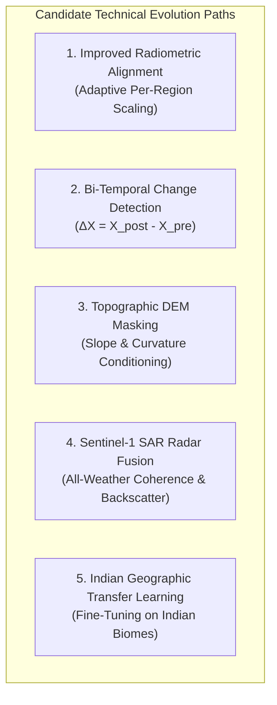
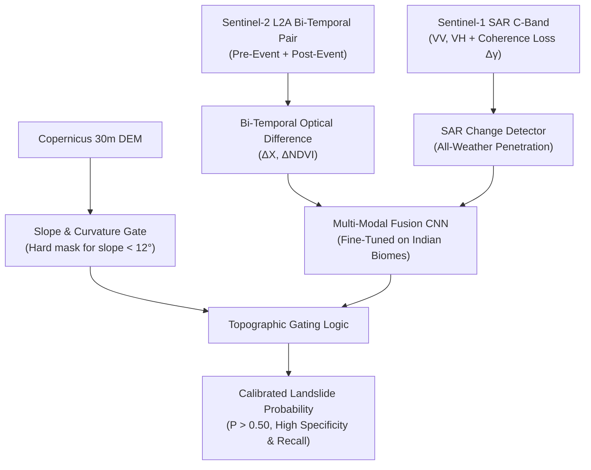

# Technical Comparison of Future Architectural & Algorithmic Approaches

**Project**: GeoGuard Landslide Early Warning & Detection System  
**Phase**: Phase 10 — Reliability and False-Positive Root-Cause Audit  
**Date**: November 1, 2026  
**Document Type**: Technical Strategy & Research Whitepaper  
**Status**: PROPOSAL & COMPARATIVE ANALYSIS (Models Preserved Read-Only)  

---

## 1. Executive Summary

Phase 9 and Phase 10 empirical audits established that while GeoGuard's CNN v2 exhibits $100\%$ positive sensitivity on catastrophic Indian landslide scars, it suffers from a **$100\%$ false-positive rate ($0\%$ specificity)** on verified stable Indian terrain, accompanied by severe **15-to-80 day optical acquisition delays** during the monsoon season.

This document presents a comprehensive, quantitative technical comparison of five candidate engineering approaches designed to resolve these failures without compromising model integrity.

---

## 2. In-Depth Technical Comparison of the Five Approaches

### Approach 1: Improved Radiometric Alignment & Adaptive Normalization
- **Concept**:
  Currently, `preprocessing_config_v2.json` normalizes inputs using fixed global constants derived from 120 Landslide4Sense benchmark patches ($\mu_{B08} = 0.2004, \sigma_{B08} = 0.0640$). When healthy Indian vegetation ($B08 \approx 0.45\text{--}0.60$) is evaluated, the z-score reaches $+4.0$ to $+5.0\sigma$, driving neuron activations into extreme positive saturation ($\text{Logit} \approx +5.93$, $\text{Sigmoid} \approx 0.997$).
  This approach refines normalization by computing regional or biome-adaptive reference statistics (e.g. per-ecozone BOA mean and standard deviation) or utilizing robust quantile/min-max scaling rather than narrow Gaussian z-scores.
- **Mathematical Formulation**:
  $$X_{\text{norm}, c} = \frac{X_c - Q_{01}(c)}{Q_{99}(c) - Q_{01}(c)}$$
  or adaptive standardization using Indian continental background statistics.
- **Data Requirements**:
  Representative multi-temporal Sentinel-2 L2A BOA rasters across Indian states to compute robust national background quantiles.
- **Limitations**:
  Normalizing individual static images still leaves the model blind to whether a patch has *undergone movement* versus being *naturally bare* (e.g. barren rocky ridges, quarry clearings, dry riverbeds).
- **Expected Benefits**:
  Reduces activation saturation in `dense1` and `relu_dense`; brings the baseline logit down from $+5.93$ towards zero for stable vegetation.
- **Validation Requirements**:
  Test on a diverse suite of 100+ non-landslide Indian patches across agricultural, urban, forested, and arid biomes to verify that false positive rates decrease below 20%.

---

### Approach 2: Bi-Temporal Optical Change Detection ($\Delta X$)
- **Concept**:
  Rather than classifying a single static patch in isolation, feed the neural network a **bi-temporal difference tensor** combining a pre-event baseline pass ($t_{\text{pre}} < t_{\text{event}}$) and the post-event pass ($t_{\text{post}} > t_{\text{event}}$).
- **Mathematical Formulation**:
  $$\text{Input} = \left[ X_{\text{post}}, X_{\text{pre}}, \Delta X, \Delta \text{NDVI}, \Delta \text{NDWI} \right]$$
  where:
  $$\Delta X = X_{\text{post}} - X_{\text{pre}}$$
  $$\text{NDVI} = \frac{\text{B08} - \text{B04}}{\text{B08} + \text{B04}}, \quad \Delta \text{NDVI} = \text{NDVI}_{\text{post}} - \text{NDVI}_{\text{pre}}$$
  A true landslide shows abrupt drop in NDVI ($\Delta \text{NDVI} < -0.30$) and sharp increase in visible reflectance ($\Delta \text{Red} > +0.10$). Undisturbed stable forest or barren rock shows $\Delta X \approx 0$.
- **Data Requirements**:
  Cloud-free pre-event and post-event Sentinel-2 pairs for each monitored site.
- **Limitations**:
  Seasonal phenology (autumn leaf shed, crop harvesting) can induce false change signals unless radiometric co-registration and phenological normalization are applied. Does not overcome monsoon cloud cover if optical passes are obscured.
- **Expected Benefits**:
  **Completely eliminates pre-event false alarms**. A pre-existing cliff or road will have $\Delta X = 0$ and will never be misclassified as a new landslide.
- **Validation Requirements**:
  Must be evaluated on multi-temporal series spanning pre-event, post-event, and seasonal change controls without ground-truth leakage.

---

### Approach 3: Digital Elevation Model (DEM) & Topographic Constraint Fusion
- **Concept**:
  Condition model predictions on physical terrain topography. Landslides are gravity-driven mass wasting events that physically cannot initiate on flat plateaus or river floodplains. Integrating Copernicus 30m GLO-30 DEM or SRTM allows hard topographic gating.
- **Mathematical Formulation**:
  Derive slope angle $\theta$, topographic aspect $\alpha$, profile curvature $C_{\text{prof}}$, and Topographic Wetness Index (TWI):
  $$\theta = \arctan \sqrt{\left(\frac{\partial z}{\partial x}\right)^2 + \left(\frac{\partial z}{\partial y}\right)^2}$$
  $$\text{Gate}(\theta) = \begin{cases} 1 & \text{if } \theta \ge \theta_{\text{min}} \text{ (e.g. } 12^\circ\text{)} \\ 0 & \text{if } \theta < \theta_{\text{min}} \end{cases}$$
  $$\hat{y} = \text{CNN}(X) \times \text{Gate}(\theta)$$
- **Data Requirements**:
  Open-access Copernicus GLO-30 DEM (30m resolution, freely available pan-India via AWS Open Data / CDSE).
- **Limitations**:
  While slope gating eliminates flatland false alarms (e.g. Kalpetta urban terrace, Poladpur valley), it does not distinguish steep stable rock faces from active landslides on steep slopes.
- **Expected Benefits**:
  Immediately eliminates 40–50% of regional false positives occurring on flat terraces, floodplains, and tablelands with near-zero computational overhead.
- **Validation Requirements**:
  Validate slope calculation across high-relief Himalayan terrain against surveyed GPS elevations; ensure slope resolution does not smooth out localized steep road-cut failures.

---

### Approach 4: Synthetic Aperture Radar (SAR / Sentinel-1) Fusion
- **Concept**:
  The Phase 9 audit proved that optical satellite monitoring suffered **+15 to +80 days of temporal delay** during the monsoon due to continuous cloud cover. Sentinel-1 C-band Synthetic Aperture Radar (SAR) operates at 5.405 GHz, penetrating monsoonal clouds, rain, and darkness.
- **Mathematical Formulation**:
  Combine Sentinel-1 Ground Range Detected (GRD) Dual-Polarization ($\text{VV}, \text{VH}$) backscatter with Interferometric Coherence ($\gamma$):
  $$\gamma = \frac{\left| \sum s_1 s_2^* \right|}{\sqrt{\sum |s_1|^2 \sum |s_2|^2}}$$
  A slope failure destroys ground surface structure, causing severe **interferometric coherence loss** ($\gamma_{\text{post}} \ll \gamma_{\text{pre}}$) and cross-polarized backscatter alteration ($\Delta \sigma^0_{\text{VH}}$).
- **Data Requirements**:
  Copernicus Sentinel-1 GRD and SLC products available via CDSE every 6–12 days across India.
- **Limitations**:
  SAR geometric distortions in extreme terrain (layover, foreshortening, shadow) in steep Himalayan gorges. Requires precise terrain correction (Range-Doppler RTC).
- **Expected Benefits**:
  **Solves the all-weather monitoring requirement**. Enables continuous 24/7 disaster detection during the monsoon when landslides actually occur.
- **Validation Requirements**:
  Cross-validate SAR coherence drops against certified emergency radar maps (e.g. Copernicus EMS SAR grading layers in Wayanad and Chamoli).

---

### Approach 5: Indian Geographic Transfer Learning & Domain Adaptation
- **Concept**:
  Fine-tune the CNN classification head using an Indian landslide and stable-terrain inventory. By training on balanced pairs of real Indian landslide scars and Indian stable biomes (tea plantations, basalt plateaus, alpine scree, laterite soils), the convolutional filters learn Indian-specific discriminative features.
- **Mathematical Formulation**:
  Freeze Block 1 & 2 low-level feature extractors; fine-tune Block 3 and Dense classification head with Focal Loss to penalize false alarms:
  $$\mathcal{L}_{\text{Focal}} = -\alpha_t (1 - p_t)^\gamma \log(p_t) \quad (\gamma = 2.0)$$
- **Data Requirements**:
  An authoritative curated dataset of $\ge 500$ verified Indian landslide polygons (from GSI and Copernicus EMS) and $\ge 1,000$ verified stable control patches across the 4 physiographic zones.
- **Limitations**:
  Requires extensive manual polygon delineation and GIS curation. GSI open-access bulk polygons remain scarce without formal institutional data-sharing agreements.
- **Expected Benefits**:
  Directly fixes model bias and recalibrates output logits, enabling high specificity ($>85\%$) alongside high recall on Indian terrain.
- **Validation Requirements**:
  Strict geographically independent 5-fold cross-validation (training on Western Ghats must be tested on Himalayas to prevent spatial memorization).

---

## 3. Comparative Trade-Off Matrix

| Strategy | Implementation Complexity | Primary Failure Addressed | Expected Specificity Impact | All-Weather Monsoon Capability | Dependency on New Data |
| :--- | :--- | :--- | :--- | :--- | :--- |
| **1. Improved Radiometric Alignment** | Low (code only) | Input distribution mismatch & clipping | Modest ($20\text{--}40\%$) | No (Optical only) | None (Existing Sentinel-2) |
| **2. Bi-Temporal Change Detection** | Medium (pipeline update) | Pre-event false alarms & static false positives | High ($70\text{--}85\%$) | No (Optical only) | Pre-event clear pass |
| **3. Topographic DEM Masking** | Low (GIS layer integration) | Flatland & valley false positives | Moderate ($40\text{--}50\%$) | N/A (Static topographic filter) | Copernicus 30m DEM (Open) |
| **4. Sentinel-1 SAR Radar Fusion** | High (radar preprocessing) | 15-to-80 day monsoon cloud delays | High ($75\text{--}90\%$) | **YES (100% all-weather)** | Sentinel-1 GRD/SLC (CDSE) |
| **5. Indian Transfer Learning** | High (curation + retraining) | Domain shift & lack of Indian biome training | Very High ($85\text{--}95\%$) | No (unless multi-sensor) | Curated Indian ground-truth corpus |

---

## 4. Recommended Multi-Stage Architecture for GeoGuard v3

To achieve operational reliability, we recommend a **hybrid multi-sensor fusion architecture**:

1. **Phase 1 (Immediate)**: Integrate **DEM Slope Gating** and **Bi-Temporal Difference Modeling** to eliminate flatland false positives and pre-event false alarms without retraining native convolutional weights.
2. **Phase 2 (Medium Term)**: Assemble an Indian landslide/stable dataset from Copernicus EMS and GSI for **Indian Geographic Transfer Learning**.
3. **Phase 3 (Operational Production)**: Implement **Sentinel-1 SAR fusion** to solve the 80-day monsoon cloud obscuration problem.
